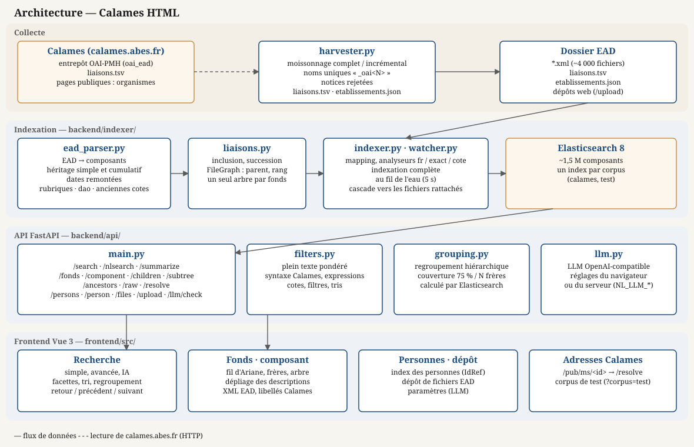

# Calames HTML

Interface web publique de recherche et navigation dans des fonds d'archives décrits en EAD, destinée à remplacer l'interface actuelle de [Calames](https://calames.abes.fr/).

- **Déploiement (Docker)** : [DEPLOY.md](DEPLOY.md)
- **Modèle de données, héritage, liaisons, plein texte** : [INDEXING.md](INDEXING.md)
- **Cahier des charges** : [CLAUDE.md](CLAUDE.md)

## Architecture



<details><summary>Version texte (Mermaid)</summary>

```mermaid
flowchart TD
    OAI[Entrepôt OAI-PMH Calames\n+ liaisons.tsv + pages publiques]

    subgraph Collecte
        HARV[harvester.py\nmoissonnage OAI-PMH\nliaisons.tsv · etablissements.json]
        DIR[Dossier EAD\n*.xml · liaisons.tsv · etablissements.json]
    end

    subgraph Indexation
        PARSER[ead_parser.py\nEAD → composants\nhéritage simple et cumulatif\ndates remontées · rubriques]
        LIA[liaisons.py\nfichiers liés : inclusion, succession]
        IDX[indexer.py\nindexation complète]
        WATCH[watcher.py\nindexation au fil de l'eau]
        ES[(Elasticsearch 8\nanalyseurs fr_text · fr_exact · cote)]
    end

    subgraph API FastAPI
        SEARCH[/search · /nlsearch · /summarize\nplein texte, facettes, tri,\nregroupement hiérarchique]
        NAV[/fonds · /component · /children\n/subtree · /ancestors · /raw · /resolve]
        OTHER[/persons · /person · /files · /upload · /llm/check]
    end

    subgraph Frontend Vue 3
        UI[Accueil · Recherche · Recherche avancée\nFonds · Composant · Personnes\nDépôt · Paramètres · redirection /pub/ms]
    end

    OAI --> HARV --> DIR
    DIR --> PARSER
    LIA --> IDX & WATCH
    PARSER --> IDX & WATCH --> ES
    ES --> SEARCH & NAV & OTHER --> UI
```

</details>

### Modules

| Module | Rôle |
|---|---|
| `backend/harvester/harvester.py` | Moissonnage OAI-PMH (noms de fichiers uniques par notice), `liaisons.tsv`, organismes responsables (`etablissements.json`) |
| `backend/indexer/ead_parser.py` | EAD → composants : champs, héritage, rubriques de description, versions numériques, commentaire de tête |
| `backend/indexer/liaisons.py` | Lecture de `liaisons.tsv`, placement des fichiers liés (`FileGraph`) |
| `backend/indexer/indexer.py` | Mapping et analyseurs, indexation complète d'un dossier, réindexation d'un fichier et de ses fichiers rattachés |
| `backend/indexer/watcher.py` | Surveille le dossier EAD et `liaisons.tsv`, maintient l'index à jour |
| `backend/api/main.py` | Application FastAPI (endpoints ci-dessous), corpus de test, organismes responsables |
| `backend/api/filters.py` | Requête plein texte (poids, syntaxe Calames, expressions, cotes), filtres, facettes, tris |
| `backend/api/grouping.py` | Regroupement hiérarchique des résultats, calculé par Elasticsearch |
| `backend/api/llm.py` | Client LLM OpenAI-compatible (réglages du client ou du serveur) |
| `frontend/src/` | Application Vue 3 (vues, composants, `api.js`, libellés Calames `utils/labels.js`) |

## Stack technique

| Couche | Outil |
|---|---|
| Moissonnage, parsing XML, indexation | Python 3.11+ + lxml |
| Index de recherche | Elasticsearch 8.19 |
| API | FastAPI |
| Frontend | Vue 3 + Vite |

## Structure du projet

```
calames-html/
├── backend/
│   ├── harvester/         # Moissonnage OAI-PMH
│   ├── indexer/           # Parsing EAD, liaisons, indexation, watcher
│   └── api/               # API FastAPI
├── frontend/              # Application Vue 3
├── data/
│   └── test/              # Corpus de test : fichiers EAD ad hoc + liaisons.tsv (versionnés)
├── demo/seed/             # 10 fichiers EAD copiés au premier démarrage Docker
├── corpora.json           # Corpus (index Elasticsearch + dossier EAD) du mode développement
├── docker-compose.yml     # Déploiement (voir DEPLOY.md)
└── *.ps1                  # Scripts du mode développement (Windows)
```

Les fichiers EAD de Calames ne sont pas versionnés : `corpora.json` indique leur dossier.

## L'interface

- **Recherche** : plein texte sur tout le texte des composants, facettes (institution, niveau,
  période, genre/forme, type de document, technique, sujet, lieu, langue, propriétaire
  précédent, numérisation), tri, syntaxe de Calames, recherche avancée par champ, recherche dans
  un fonds, recherche en langage naturel et résumé par LLM (« ✦ IA »).
- **Regroupement** : un parent remplace ses descendants trouvés quand assez de ses enfants
  correspondent ; il indique combien de composants il regroupe.
- **Navigation** : fil d'Ariane, frères (curseur), arbre du fonds ; dépliage des descriptions
  des enfants (un, tous les enfants directs jusqu'à 50, tout le sous-arbre jusqu'à 200
  composants) ; XML EAD natif à chaque niveau ; « Retour aux résultats » et navigation
  résultat précédent / suivant.
- **Fichiers liés** (`liaisons.tsv`) : un fichier maître et ses fichiers rattachés forment une
  seule hiérarchie.
- **Affichage repris de Calames** : rubriques de description sous les libellés de Calames,
  rôles en clair, organisme responsable, anciennes cotes, versions numériques ; la cote est
  toujours affichée avant le titre ; les adresses Calames (`/pub/ms/<id>`) redirigent vers nos
  pages.
- **Paramètres** : configuration du LLM dans le navigateur.
- **Corpus de test** (`?corpus=test`) : description de chaque fichier de test, valeurs propres
  ou héritées signalées.

---

## Lancer le projet

Deux modes : **Docker** (serveur de démonstration, voir [DEPLOY.md](DEPLOY.md)) et **sans
Docker** (développement, Windows).

| Service | Développement | Docker |
|---|---|---|
| Frontend | `http://localhost:5173` | `http://<serveur>:${HTTP_PORT}` (80 par défaut) |
| API | `http://localhost:8000` | non exposée : `/api` sur le port du frontend |
| Elasticsearch | `http://localhost:9200` (conteneur `calames-es`) | non exposé |

### Corpus

En développement, les corpus sont définis dans `corpora.json`, utilisé seulement par les scripts
`dev.ps1`, `index.ps1` et `restart-api.ps1` (`data_dir` relatif à la racine du dépôt, ou absolu) :

| Corpus | Index Elasticsearch | Données |
|---|---|---|
| `calames` | `ead_components_calames` | Moissonnage complet de Calames (`data_dir`) |
| `test` | `ead_components_test` | Fichiers EAD de test (`data/test/`) |

Chaque corpus a son propre index : basculer de l'un à l'autre ne détruit pas l'index de l'autre.

**Corpus de test sans relancer** : il est réindexé automatiquement à chaque démarrage de l'API
(quelques secondes) et reste interrogeable à côté du corpus principal :

- site : `http://localhost:5173/?corpus=test` (un bandeau le signale ; le choix est mémorisé pour
  l'onglet, `?corpus=` ou le lien du bandeau ramène au corpus principal) ;
- API : ajouter `corpus=test` à n'importe quel appel, par ex. `/search?q=lettre&corpus=test`.

Variables : `TEST_DATA_DIR` (défaut `data/test`, monté en lecture seule en Docker) et
`TEST_ES_INDEX` (défaut `ead_components_test`). Pas de dépôt de fichiers dans ce corpus.

---

## Mode développement (sans Docker)

### Prérequis

- Python 3.11+
- Node.js 18+
- Docker (Elasticsearch tourne dans le conteneur `calames-es`, créé par `es-dev.ps1`)

### Démarrage rapide (Windows)

```powershell
powershell -File dev.ps1                 # corpus "calames" par défaut
powershell -File dev.ps1 -Corpus test   # corpus "test" comme corpus principal
```

Le script démarre le conteneur Elasticsearch (`es-dev.ps1`), puis l'API et le frontend dans
deux fenêtres. Il arrête d'abord les processus existants sur les ports 8000 et 5173. L'index est
conservé dans le volume Docker `calames_es_dev`.

| Script | Rôle |
|---|---|
| `stop.ps1` | Arrête l'API, le frontend et le conteneur Elasticsearch |
| `restart-api.ps1 [-Corpus test]` | Relance l'API seule (lit les secrets dans `secrets.ps1`, sans les exposer dans la ligne de commande) |
| `index.ps1 [-Corpus test]` | Réindexe un corpus (index supprimé puis recréé) |
| `es-dev.ps1` | Crée ou démarre le conteneur Elasticsearch de développement |

`secrets.ps1` (non versionné) peut définir `NL_LLM_BASE_URL`, `NL_LLM_API_KEY`, `NL_LLM_MODEL`
(LLM par défaut du serveur).

### Étapes détaillées

#### 1. Dépendances

```bash
cd backend && pip install -r requirements.txt
cd frontend && npm install
```

#### 2. Moissonnage

```bash
cd backend/harvester

python harvester.py --out <dossier>               # moissonnage complet (~4 000 notices, ~2 h 30)
python harvester.py --out <dossier> --incremental # notices modifiées depuis le dernier passage
python harvester.py --dry-run --limit 10          # tester sans télécharger
python harvester.py --set 751059803               # un établissement (setSpec OAI)
python harvester.py --out <dossier> --liaisons-only       # liaisons.tsv seulement
python harvester.py --out <dossier> --etablissements-only # organismes responsables seulement
```

Chaque passe télécharge aussi `liaisons.tsv` et complète `etablissements.json`. Les fichiers sont
nommés d'après leur `eadid`, suivi de `_oai<N>` (numéro OAI = FileId Calames) quand l'eadid ne
contient pas déjà ce FileId : plusieurs notices partagent parfois le même eadid. Une notice que le
serveur refuse est notée « rejetée » sans arrêter le passage ni bloquer la date du dernier
moissonnage.

#### 3. Indexation

```bash
cd backend/indexer
python indexer.py <dossier> --host http://localhost:9200 --index ead_components_calames
```

L'index est **toujours supprimé et recréé** (c'est aussi la seule façon d'appliquer un
changement de mapping ou d'analyseur). Environ 17 minutes pour tout Calames (~1,5 million de
composants). Avec un Elasticsearch sécurisé, ajouter `--password <mot de passe de elastic>`.
`liaisons.tsv` est pris dans le dossier (ou `--liaisons FICHIER`).

#### 4. Lancer manuellement les trois services

```bash
# Elasticsearch
docker run -d --name calames-es -p 9200:9200 -e discovery.type=single-node \
  -e xpack.security.enabled=false -e "ES_JAVA_OPTS=-Xms1g -Xmx1g" \
  -v calames_es_dev:/usr/share/elasticsearch/data \
  docker.elastic.co/elasticsearch/elasticsearch:8.19.3

# API
cd backend
ES_HOST=http://localhost:9200 ES_INDEX=ead_components_calames DATA_DIR=<dossier> \
  uvicorn api.main:app --reload --port 8000

# Frontend
cd frontend && npm run dev
```

Variables d'environnement de l'API :

| Variable | Défaut | Description |
|---|---|---|
| `ES_HOST` | `http://localhost:9200` | URL d'Elasticsearch |
| `ES_USER` | `elastic` | Utilisateur (utilisé seulement si `ES_PASSWORD` est renseigné) |
| `ES_PASSWORD` | _(vide)_ | Mot de passe (vide = pas d'authentification) |
| `ES_INDEX` | `ead_components` | Nom de l'index |
| `DATA_DIR` | `data/calames` | Dossier EAD : XML brut (`/raw`), `etablissements.json`, dépôts |
| `STATE_FILE` | `/state/watcher.json` | État du watcher (statuts de la page Déposer) |
| `UPLOAD_TOKEN`, `MAX_UPLOAD_MB` | _(vide)_, `20` | Dépôt de fichiers par le web (vide = désactivé) |
| `SIBLING_THRESHOLD` | `3` | Seuil de la règle des N frères (`sibling_grouping=true`) |
| `COVERAGE_THRESHOLD` | `0.75` | Seuil de couverture du regroupement par défaut |
| `NL_LLM_BASE_URL` | `https://api.openai.com/v1` | LLM du serveur, à défaut de réglages client : base URL OpenAI-compatible |
| `NL_LLM_API_KEY` | _(vide)_ | LLM du serveur : clé API (vide et pas de réglages client : recherche brute) |
| `NL_LLM_MODEL` | `gpt-4o-mini` | LLM du serveur : modèle (ex. `gemma-4-31b`, `mistral`, `llama3`) |
| `TEST_DATA_DIR`, `TEST_ES_INDEX` | `data/test`, `ead_components_test` | Corpus de test (`?corpus=test`) |

Le LLM se configure normalement **côté client**, dans la page **Paramètres** du site (URL de
base, clé, modèle) : les réglages restent dans le navigateur et sont envoyés à l'API dans les
en-têtes `X-LLM-Base-Url`, `X-LLM-Api-Key` et `X-LLM-Model` des requêtes IA (`/nlsearch`,
`/summarize`, `/llm/check`). Les variables `NL_LLM_*` ne servent que si le navigateur n'envoie
aucun réglage ; la clé du serveur n'est jamais envoyée à une URL choisie par le client.

Le fichier `frontend/.env.local` peut définir l'URL de l'API (défaut `http://localhost:8000`) :

```env
VITE_API_URL=http://localhost:8000
```

### Tests

```bash
cd backend
python -m pytest              # ~90 tests ; ceux qui interrogent Elasticsearch sont ignorés s'il ne répond pas
```

Les fichiers de `data/test/` sont des cas construits pour les tests : chacun décrit en tête ce
qu'il teste, l'interface l'affiche avec `?corpus=test`.

---

## Endpoints de l'API

Tous acceptent `corpus=test` (corpus de test).

| Méthode | URL | Description |
|---|---|---|
| GET | `/fonds` | Fonds de premier niveau (fichiers non rattachés à un autre) |
| GET | `/fonds/{ead_id}` | Racine d'un fichier (rattaché ou non), avec nombre de descendants et organisme responsable |
| GET | `/component?node_id=` | Un composant (héritage appliqué), avec nombre de descendants et organisme responsable |
| GET | `/resolve?id=` | Composant d'une adresse Calames (`FileId-<N>` ou `@id`) : le frontend redirige `/pub/ms/<id>` et `/pub/#details?id=<id>` |
| GET | `/children?node_id=[&details=true]` | Enfants directs, dans l'ordre, avec leur nombre de descendants (et leur description) |
| GET | `/subtree?node_id=[&max=]` | Sous-arbre complet avec descriptions (refusé au-delà de `max`, 500 au plus) |
| GET | `/ancestors?node_id=` | Chaîne d'ancêtres (fil d'Ariane) |
| GET | `/raw?node_id=[&children=true]` | XML EAD natif d'un composant, sans ses composants enfants par défaut |
| GET | `/search` | Recherche plein texte, facettes, tri, regroupement hiérarchique |
| GET | `/nlsearch?q=` | Recherche en langage naturel (LLM → Elasticsearch) |
| GET | `/summarize?q=` | Résumé LLM des résultats d'une recherche |
| GET | `/llm/check` | Teste la configuration du LLM (bouton « Tester » des Paramètres) |
| GET | `/persons` | Index des personnes avec identifiant IdRef/Sudoc |
| GET | `/person?name=` | Composants associés à une personne (par nom ou IdRef) |
| GET | `/files` | Fichiers du dossier EAD et statut d'indexation |
| POST | `/upload` | Dépôt d'un fichier EAD (jeton `UPLOAD_TOKEN`), indexé par le watcher |

### Paramètres de `/search`

| Paramètre | Type | Description |
|---|---|---|
| `q` | string | Requête plein texte |
| `level` | string | Niveau EAD (`fonds`, `series`, `subseries`, `file`, `item`, `recordgrp`…) |
| `ead_id` | string | Restreindre à un instrument de recherche et aux fichiers qui y sont rattachés |
| `date_from`, `date_to` | int | Années de début et de fin (incluses) |
| `lang` | string | Code langue (`fre`, `eng`, `lat`…) |
| `subject`, `geo_name`, `genre_form`, `creator`, `corp_name`, `pers_name` | string | Texte cherché dans ce seul champ |
| `work_title` | string | Titre d'œuvre (plein texte, `controlaccess/title`) |
| `function` | string | Fonction (plein texte, `<function>`) |
| `subject_norm`, `geo_name_norm`, `genre_form_norm`, `gff_norm`, `tdd_norm`, `technique_norm`, `corp_name_norm`, `century`, `repository`, `repository_id` | string | Filtres exacts (facettes) ; la plupart ont une variante `_excl` |
| `provenance` | string | Propriétaire précédent (forme exacte, noms au rôle 390) |
| `dao` | bool | Seulement les composants avec une version numérique |
| `sort` | string | `relevance` (défaut), `title_asc`, `title_desc`, `date_asc`, `date_desc` |
| `limit`, `offset` | int | Pagination (`limit` 1–100, défaut 20 ; `offset` ≤ 9 900) |
| `sibling_grouping` | bool | Règle des N frères au lieu de la couverture (défaut `false`) |

Syntaxe de `q` (celle de Calames) : `mot1 OR mot2` ou `mot1 | mot2`, `-exclu`, `+requis`,
`^début` (troncature), `"expression exacte"`. Sans opérateur, tous les mots doivent être
présents, éventuellement dans des champs différents ; une faute de frappe est tolérée à partir
de 7 lettres, deux à partir de 11. La cote, actuelle ou ancienne, se cherche sous n'importe
quelle forme (« Ms 1234 » = « ms1234 »). Le détail des champs et des poids est dans
[INDEXING.md](INDEXING.md#plein-texte--comparaison-avec-calames).

La réponse contient `total` (entrées après regroupement) et `total_hits` (composants
correspondants). Les facettes comptent les composants correspondants.

---

## Indexation (résumé)

Le détail est dans [INDEXING.md](INDEXING.md).

- **Héritage simple** — le plus proche ancêtre remplace le vide : langue, date, conditions
  d'accès et d'utilisation, organisme responsable.
- **Héritage cumulatif** — les valeurs s'accumulent sans doublon : sujets, lieux, genres/formes,
  collectivités, personnes, familles, titres d'œuvres, fonctions, provenance.
- **Liaisons entre fichiers** — les fichiers liés dans `liaisons.tsv` forment une seule
  hiérarchie : la racine d'un fichier rattaché devient un enfant de la racine de son parent et en
  hérite.
- **Regroupement hiérarchique** — avec une requête texte et sans filtre `level`, un parent
  remplace ses descendants trouvés quand ses enfants directs trouvés (ou eux-mêmes regroupés)
  atteignent `COVERAGE_THRESHOLD` (75 %) de ses enfants, ou `SIBLING_THRESHOLD` (3) avec
  `sibling_grouping=true`. La règle s'applique de bas en haut ; un parent regroupé porte
  `grouped_count`, son nombre de descendants trouvés.

Le parser gère l'EAD 2002 avec ou sans namespace, les `<c>` directs ou dans un `<dsc>`, `id` ou
`xml:id` (repli sur un identifiant `auto-N`), et un `<eadid>` vide (repli sur `@identifier`).
